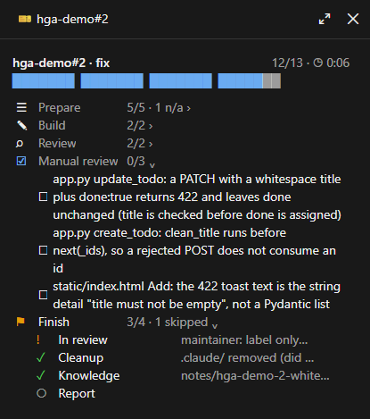
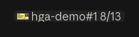
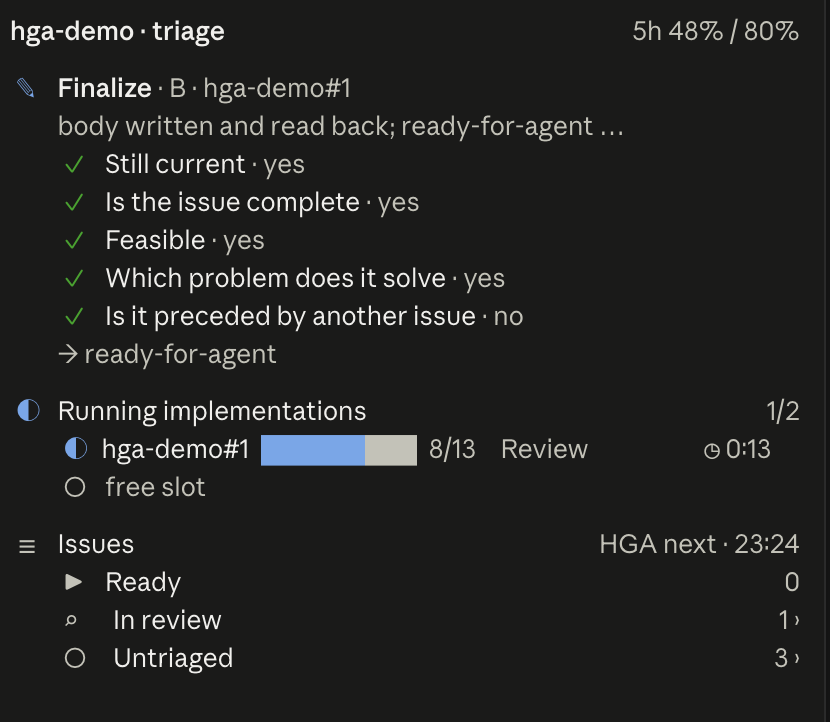

# hga — from GitHub issue to reviewed pull request

One Claude Code plugin with six skills, three live panes and a progress band. An issue's path:
**`/hga:intent`** turns a few sentences into an intent.md in the knowledge base, by interviewing and research,
**`/hga:new-issue`** makes an issue from it, **`/hga:triage`** prepares it, **`/hga:issue`** takes it to a
reviewed PR, **`/hga:knowledge`** keeps what was learned on the way, and **`/hga:init`** sets everything up.

```
/hga:intent → /hga:new-issue → /hga:triage → /hga:issue
```

| | What it does |
|---|---|
| `/hga:init [new \| join <URL> \| check]` | Checks the prerequisites, creates or joins the knowledge base, writes the team and machine configuration |
| `/hga:intent [intent]` | Interviews (1–3 questions per round) and researches (knowledge base, the default branch, issues, docs) until the picture is complete; an intent.md under `notes/`, with a readiness gate (`intent_check.py`: PASS / WARN / BLOCK) and the author's approval; then the issue and the triage |
| `/hga:new-issue <intent>` | An issue from the intent: readiness gate, duplicate search, the body from the intent's sections, create and read back, board (Todo) and type, the issue number back into the intent |
| `/hga:triage [issue]` | Vets an issue (five questions), finalizes it for implementation, picks the next one, launches a parallel implementation session |
| `/hga:issue <issue>` | Claim (Slack or GitHub) → In Progress → worktree → build and test, live test in the browser (with a tester's verdict and fix rounds) → PR → review → Done → cleanup → knowledge base → report, on a verified checklist |
| `/hga:knowledge [question]` | Reads and writes the knowledge base, with dates and sources |
| `/issue-pane` | Toggles the issue pane (the running issue's 13 steps) |
| `/triage-pane [refresh \| owner/repo]` | Toggles the triage dashboard |
| `/intent-pane` | Toggles the intent pane (the band above the prompt comes by itself) |

> The panes are built on Claude Code's mod API (early access, it may change from release to release). Written
> and tested with Claude Code 2.1.289. The skills work without the panes.

## Install

```
claude plugin marketplace add hgahub/claude-plugins
claude plugin install hga@hga-plugins
```

Then run `/hga:init` once per machine. Update with `claude plugin update hga@hga-plugins`, then
`/reload-plugins` (or a new session).

**Prerequisites** — without them the skills stop, they do not break anything:

- `gh` logged in, with the `repo` scope (and `project` if you use a GitHub project board), and write access to
  the repositories you work on.
- Python 3.9+ (the scripts use only the standard library; on Windows, a named time zone needs `pip install
  tzdata`). `uv` for live tests of Python apps (optional).
- Optional: a Slack MCP connector (claims and reports in a channel), Claude in Chrome or the built-in browser of
  the desktop app (live tests), a review bot on your repositories (Codex, Copilot or Greptile).

`/hga:init check` (or `python3 <plugin>/skills/issue/scripts/hga_issue.py doctor`) shows what is missing.

## Configuration

Two layers, merged (`hga_issue.py config` prints the result):

- **Team** — `hga.config.json` in the knowledge base, versioned and shared:

  ```json
  {
    "language": "en",
    "timezone": null,
    "github": {
      "project": null,
      "fields": { "status": "Status", "iteration": "Iteration", "priority": "Priority", "effort": "Effort" },
      "statuses": { "todo": "Todo", "in_progress": "In Progress", "done": "Done" }
    },
    "labels": { "in_progress": "in-progress", "in_review": "in-review", "closed": "done" },
    "slack": null,
    "review": { "provider": "local", "ask_after_rounds": 5 },
    "parallel": { "max_per_repo": 2, "usage_ceiling_pct": 80 }
  }
  ```

- **Machine** — `~/.claude/hga/config.json`: `knowledge_dir` (default `~/.hga/knowledge`), and any team field
  to override on this machine.

| Key | Meaning |
|---|---|
| `language` | Language of everything written outward: commits, PRs, issues, comments, Slack, notes. Code follows the repository's own conventions. |
| `timezone` | `null` = the machine's; an IANA name makes "today" (Slack claims, iterations) the same for the whole team. |
| `github.project` | `null` = no board: the status is kept with labels. Otherwise the project's title; its status field and option names map through `fields.status` and `statuses`. Iteration, Priority and Effort are used only if they exist. |
| `labels` | Without a board: `in_progress` while an agent works, `in_review` after step 9 (implemented, waiting for the maintainer). `closed` is the **maintainer's** closing label, in both modes — the agent never sets it, and triage treats an issue with it as complete. |
| `slack` | `null` = claims and reports are GitHub comments on the issue. Otherwise `{"channel": "#dev", "channel_id": "C…"}`. |
| `review.provider` | `local` (the `code-review` skill), `codex`, `copilot` or `greptile` (a bot on GitHub, in addition to the local review). `ask_after_rounds`: from this round on, the maintainer decides whether to close the review. |
| `parallel` | `/hga:triage` launches at most `max_per_repo` implementations per repository, and none above `usage_ceiling_pct` of the 5-hour plan usage. |

## The knowledge base

A file-based collection of notes about your applications and environments, usually a private git repository
shared by the team. Every claim carries a date and a source, so it is treated as evidence, not as truth. The
skills read it before they work (the app's page, its workflow page, earlier notes about the issue) and write
to it afterwards.

```
~/.hga/knowledge/
  00-index.md        the entry point: what is where
  apps/              one page per application
  environments/      hosts, ports, deployments
  architecture/      what calls what
  notes/             new, dated findings (/hga:issue step 11 writes here): <app>-<issue>-<topic>.md,
                     and the intents of /hga:intent: <app>-intent-<topic>.md
  inbox/             raw input waiting to be processed
  workflow/          /hga:issue's app-specific pages (start, gate, live test, pitfalls)
  quality/           contradictions between sources and measurements
  policies/          source-order.md, the evidence rules
  map/               generated note map per app
  hga.config.json    the team configuration
```

- **Reading:** `/hga:knowledge <question>`, or step 0 of `/hga:issue` and `/hga:triage`. The skill pulls first.
- **Writing:** a new finding goes to `notes/` with frontmatter (`title`, `verified_at`, `status`,
  `review_after_days`) and a `## Sources and verification` section. Canonical pages change only with evidence.
  No secrets, passwords, tokens or personal data.
- **After writing:** `build_map.py` (the note map), `validate_kb.py` (frontmatter, links, credential-like
  content), then commit and push the own pages (not `git add -A`). The skills do this themselves; both scripts
  are in `skills/knowledge/scripts/`.

## Review providers

| Provider | How it is asked | Waiting |
|---|---|---|
| `local` | The `code-review` skill on the PR, repeated after each round of fixes | — |
| `codex` | `@codex review` comment (the Codex GitHub app must be installed) | `review-wait` reads the Codex summary comment and its inline findings |
| `copilot` | `gh pr edit --add-reviewer @copilot` (Copilot code review must be enabled; gh 2.88+) | `review-wait` waits for Copilot's review of the head commit |
| `greptile` | `@greptileai` comment (the Greptile GitHub app must be installed) | `review-wait` waits for Greptile's review of the head commit |

The local review runs on every PR, whatever the provider. Copilot and Greptile support is newer than Codex's:
report problems as issues.

## The panes

### Issue pane

`/hga:issue`'s 13 steps (0 Start … 12 Report) in four sections (Prepare, Build, Review, Finish). At the top the
issue, the counter and the elapsed time, below it a progress bar per section; each section is one row
(`5/5 ›`, `1/2 · 1 skipped ›`), and only the running section is open, with its steps and evidence. Clicking a
section's name opens or closes it.



- Steps: ✓ done (green) · ◐ in progress · ! skipped, with the reason · ○ not yet. Section icons: ☰ Prepare,
  ✎ Build, ⌕ Review, ⚑ Finish. One accent color (the running step and the bar), green checks and a warning
  color — everything else dim; colors are theme keys.
- The model reports the state with the `mcp__hga__step` tool (`issue`, `step` 0–12, `state`, `evidence`,
  `verb`, `started_at`); `/hga:issue`'s checklist section requires a call at every state change.
- A button on the right of the footer (`🎫 web-app#142 8/13`, dim while the pane is closed) toggles the pane;
  so does `/issue-pane`. The first report opens the pane; once you close it, only a new issue reopens it.

  

- Every report writes its state to `~/.claude/hga/issue/<owner>-<repo>-<n>.json`: from there the triage panel
  sees the implementations running in parallel. After a plugin update or restart the pane restores the session's
  own issue from that file.

### Triage panel

In the same style: the running implementations of the repository (with a slot counter against
`parallel.max_per_repo`), the finished ones, the current triage branch with the five verdicts, and the issue
groups of `hga_issue.py next` (Ready, Needs a human, Blocked, Needs info, In progress, In review, Untriaged).



- **Launch:** the implementation starts as a **subtask** of the triage session (`start_session`, with `cwd` =
  the repository's main checkout): it shows nested under the triage in the sidebar, the triage gets a
  notification when it ends a turn, and archives it after the merge. Archiving the triage archives its subtasks
  too. (Before 0.2.0 a manual scheduled task, `hga-issue-<repo>-<n>`, launched it.)
- **Activation:** loading `/hga:triage` (or the Skill tool), `/triage-pane`, a `next` run, or a `phase` call. The
  repository comes from the session's git remote; `/triage-pane owner/repo` switches.
- **Running:** from the issue pane's state files, every minute. An unfinished issue silent for 60 minutes is
  marked stalled and frees its slot; past Done (step 9) it no longer takes a slot. Finished issues stay for a day,
  unfinished ones for a week; ✕ hides one until it reports again. In the desktop app, an issue's name jumps to
  its session.
- **Issues:** `hga_issue.py next <repo> --json` every five minutes, and right away after a session changes a
  label, a prerequisite or a status.
- **Why `-pane`:** `/issue` and `/triage` are taken by the plugin's own skills (`/hga:issue`'s short name is
  `/issue`). If a pane command cannot be registered, the mod says so in a toast; the panes still work from the
  footer button and the skills.

### Intent pane and progress band

Shows `/hga:intent`'s run, in the same color scheme as the other two panes.

- **Pane** (`/intent-pane`): at the top the intent's name and the issue, below it the **full picture** bar — the
  coverage of the intent.md's eight sections (✓ done = 1, ◐ partial = ½, ○ empty), the number of open questions
  and the readiness gate's verdict (PASS green, WARN yellow, BLOCK red). Then the nine stations (Intent, Context,
  Interview, Research, Draft, Approval, Knowledge base, Issue, Handoff) with their evidence, and the sections one
  by one.
- **Progress band above the prompt:** the whole path in one row —
  `◎ web-app-intent-xlsx-source  ◐ Intent 6/8 · 1 question · WARN › ○ Issue › ○ Triage › ○ Build  ✕`.
  Issue turns green with the issue number, Triage shows its branch if it runs in the same session
  (`mcp__hga__phase`), and Build shows the counter and the clock from the issue's state file
  (`~/.claude/hga/issue/`), whichever session it runs in. Clicking the intent's name opens the pane, `✕` hides
  the band (a new intent shows it again); during a survey the band gives way.
- The model reports with the `mcp__hga__intent` tool (`intent`, `step` 0–8 + `state`, `evidence`, `sections`,
  `questions`, `verdict`, `file`, `issue`); only the changed fields are needed.
- Every report writes the state to `~/.claude/hga/intent/<intent>.json`. After a plugin update or restart, at
  start and on `/intent-pane`, the intent comes back from there — only the session's own (by the `session`
  field). If the write fails, the pane works the same.

### The readiness gate

`skills/intent/scripts/intent_check.py <intent.md> [--json]` — without a model: from 100 points, −45 per error
and −20 per warning; BLOCK if there is an error, PASS from 85. Errors: a missing title; an empty problem, desired
outcome or affected section; no numbered criterion; no "Given … when … then …" scenario; a `[blocking]` open
question; a leftover placeholder (`<…>`, TBD, TODO). Warnings: no edge case, fewer scenarios than criteria, a
current state without a SHA, an empty "Out of scope". The `##` headings and the scenario keywords are fixed
English markers, whatever the configured language. Self-test: `--self-test`.

## Development

```
claude --plugin-dir ./plugins/hga     # load it; this also generates the types
claude plugin validate plugins/hga
claude plugin test plugins/hga
python3 -m pytest plugins/hga/tests/py
```

Only one hooks module can be loaded per plugin, so `hooks/register.tsx` calls the three panes' `register`. An
event without a matcher can be bound only once: the panes' `ui.close` filter on `id`, and the triage panel's
`session.start` uses a `{ cwd: /(?:)/ }` matcher, the intent pane's `{ cwd: /^/ }`, both matching every session. `isInteractive` is not a usable
filter: the desktop app runs in SDK mode, where it is false.
